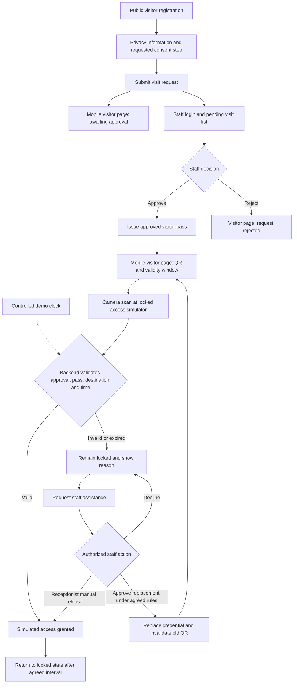

# Heaven Access — Preliminary Screen Flow and Wireframes

Planning draft, 6 November 2026. These are low-fidelity artifacts for discussion, the supporting report, and a presentation slide. They are not implemented screens or a final specification. Fields, roles, renewal rules, and the time window remain subject to review.

## Screen flow



Updates to approval, credential replacement, and device state must appear in the appropriate open tabs without manual refresh. Arrows describe the user journey and shared events; they do not imply that the staff interface is publicly accessible from the registration page. Requesting assistance must not automatically grant access.

## Low-fidelity wireframes

### 1. Public visit request

```text
+--------------------------------------+
| HEAVEN ACCESS           Visit request |
|                                      |
| Your name       [..................] |
| Contact method* [..................] |
| Company         [Select          v] |
| Department/room [Select          v] |
| Visit date      [  DD / MM / YYYY  ] |
| Visit time      [      HH:MM       ] |
|                                      |
| Why we need your information         |
| [Read privacy notice]                |
| [ ] Consent interaction*             |
|                                      |
|          [ Request visit ]           |
| Approval is required before access.  |
+--------------------------------------+
```

*Exact contact fields and the lawful basis/wording of consent remain open. The public form does not create an immediately usable pass. No administration of companies or departments is included.

### 2. Staff login and operational visit review

```text
+--------------------------+    +-----------------------------------------+
| STAFF SIGN IN            |    | HEAVEN ACCESS     Staff       [Sign out]|
| Username [.............] |    | Pending visits | Approved | Access log* |
| Password [*************] |    |-----------------------------------------|
|       [ Sign in ]        |    | Visitor   Destination  Time    Status   |
+--------------------------+    | Alex      Room 401     14:00   Pending  |
                                |                                         |
                                | Selected visit details                  |
                                | [Approve] [Reject*]                     |
                                | [Replace pass*]                         |
                                |                                         |
                                | Receptionist assistance                 |
                                | Device [Select v]  Reason [..........]  |
                                | [Manual release]                        |
                                +-----------------------------------------+
```

*Suggested operational controls for discussion. Approval and manual release are confirmed; separate role permissions, logs, rejection, and replacement rules need refinement. Seeded staff accounts remove the need for a user-management area.

### 3. Access-device simulator

```text
+--------------------------------------------------+
| HEAVEN ACCESS          Elevator / gate simulator   |
|                                                  |
|                   LOCKED                         |
|                                                  |
|        +-------------------------------+         |
|        |                               |         |
|        |      CAMERA QR SCAN AREA      |         |
|        |                               |         |
|        +-------------------------------+         |
|               [ Enable camera ]                  |
|                                                  |
| Result: Waiting for a visitor pass                |
| Destination: --                                  |
|                                                  |
| DEMONSTRATION CONTROLS                            |
| Fictional current date/time [..................] |
| [Apply demo time]       [Reset demo time*]         |
| Simulation only - no physical hardware connected |
+--------------------------------------------------+
```

State variants: access granted, outside validity window, invalid/revoked QR, camera permission denied, and connection unavailable. Manual release originates from authorized staff action and updates this view. The fictional clock is a controlled demo feature, not a visitor permission.

### 4. Mobile-first visitor pass

```text
+---------------------------+
|       HEAVEN ACCESS       |
|       Your visit pass     |
|                           |
| Status: Approved          |
| Alex - Company A          |
| Destination: Room 401     |
| Visit: 14:00              |
| Valid: 13:30 - 14:30*     |
|                           |
|     +---------------+     |
|     |               |     |
|     | QR PLACEHOLDER|     |
|     |               |     |
|     +---------------+     |
|                           |
| Present at the scanner.   |
| [Request assistance*]     |
| [Privacy information]     |
+---------------------------+
```

*Times are illustrative of the proposed ±30-minute window. Before approval, display a waiting state without a usable QR. On expiry/revocation, make the unavailable state clear. An authorized replacement updates the same visitor view; reissuing must not silently extend access without an agreed approval rule. Simulated delivery and the private link mechanism remain to be defined.

## Use in the report and presentation

- Report: include the reviewed flow, explain actors and alternative paths, and cite this planning artifact by date/version.
- Planning slide: place reduced versions of the four wireframes side by side, connected as request → approval → pass → validation. Label it “Initial low-fidelity design — 6 November 2026”.
- Suggested slide caption: “We separated registration, staff authorization, visitor credentials, and access validation before implementation. Early wireframes exposed decisions about expiry, manual assistance, and live updates.”
- Preserve meaningful revisions and describe changes actually made. Do not invent completed user testing, interviews, or approvals.
- Export clean diagram/wireframe graphics when assembling the final report/slides; these Markdown drafts are the source material for now.
