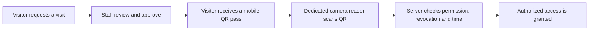
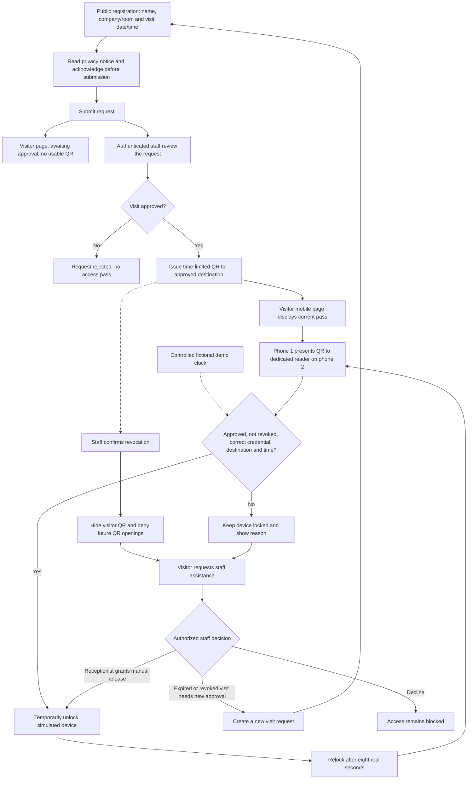

# Heaven Access — Visitor Access Flow

Supporting flow artifact, revised 15 November 2026 to reflect the implemented visitor prototype. Use these diagrams to explain the proposed MVP to the group and as source material for the report and presentation. GitHub renders the Mermaid diagrams below.

[Issue #1](https://github.com/lipex360x/Heaven-Access/issues/1) is the Source of Truth for lifecycle decisions and review. This artifact reflects the accepted single staff role, inclusive ±30-minute Europe/Dublin window, reusable QR, confirmed revocation and new-request-after-expiry/revocation rules. See [design.md](design.md) for screen wireframes.

## Overview for a presentation slide

This is the successful journey. A request alone does not grant access; failed validation keeps the device locked. Delivery and the physical access device are simulated.

## Detailed flow and assistance paths

## How the screens work together

| Stage | Screen / actor | Shared change |
| --- | --- | --- |
| Request | Public registration / visitor | Pending visit appears in the staff interface |
| Review | Staff interface / authorized reviewer | Visitor page reflects the approval decision |
| Pass | Mobile visitor page / visitor | Approved QR and validity details are available |
| Validation | `/device/reader` / camera phone | Server checks approval, revocation, credential, destination and effective time |
| Access | `/device/display` / tablet | Device temporarily unlocks or stays locked with a reason |
| Revocation | Reception / authenticated staff | Confirmation records actor/time, removes visitor QR and blocks future QR authorizations |
| Assistance | Staff interface / receptionist | Staff can manually release access; expiry/revocation requires a new request and approval |

Screens automatically refresh state through approximately one-second polling in the single Next.js application. This is near-real-time synchronization, not immediate server push; WebSocket/SSE infrastructure is not required for the initial prototype. QR validation and manual-release authorization remain server-side and do not depend on the polling interval.

The public form collects visitor name, seeded company/room destination and scheduled date/time; no email or phone is required. One authenticated staff/reception role can approve, reject, revoke an approved pass and manually release access. The accepted privacy interaction requires an initially unchecked notice acknowledgement before submission. Without acknowledgement, no visit is created; offer reception assistance. Complete notice content, lawful-basis analysis and retention remain under issue #3.

QR authorization is valid from 30 minutes before through 30 minutes after the scheduled time, both boundaries inclusive, in Europe/Dublin. Repeated access within the window is allowed. Expiry requires a new request and approval; the old credential remains expired. The demo clock must be controlled by authorized staff, separate from real session/audit time.

The user requires access counts. Accepted counting semantics for the shared contract: one count per successful QR-authorized unlock, suppressing repeated camera frames while unlocked; denied scans do not count. Manual-release events remain separately identifiable. Display counts in the existing staff interface, without adding a dashboard. The accepted issue #1 contract specifies eight-real-second unlocks and atomic event deduplication.

This flow does not establish occupancy tracking, checkout, physical tailgating prevention or real elevator integration. Cross-building blocking is a future extension, outside the single-building prototype.

See [data-state-contract.md](data-state-contract.md) for the accepted data/API boundary and technical defaults, including eight-second unlocks, count deduplication, separate manual events and the controlled advancing demo clock. Clock rewind is a staff-only scenario replay, not a renewal operation; derived time states can change during that replay without changing the stored approval window.

## Revocation and recurring-occupant boundary

Revocation preserves the original approval and access history, with a separate real actor/time record. It blocks new QR openings, including scans of downloaded images, and cannot be undone by clock replay. A previously granted opening completes its existing eight-second interval. A deliberate, attributable manual override remains possible without restoring the QR. A revoked visitor needs a new request and approval.

The dedicated reader is a presentation mode of the same device, not an additional controller: phone 1 shows the pass, phone 2 opens `/device/reader` and starts the camera, and the tablet opens `/device/display`. `/device` retains destination/clock/manual controls. Use the hosted HTTPS origin for phone camera access.

Bella identified the separate needs of employees and other regular occupants. The current request/approval/±30-minute pass is a temporary-visitor workflow; staff sign-in permits operating the application, not permanent physical entry. Managed recurring credentials with permitted destinations/schedules, review and revocation are an unimplemented future option, described in [future-improvements.md](future-improvements.md). Do not simulate this by extending a visitor QR indefinitely. Bella explains this boundary briefly in the closing/evaluation slot; Felipe introduces the demonstration as a temporary visit.
