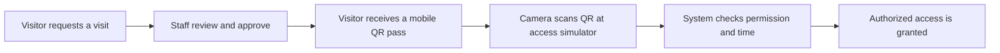
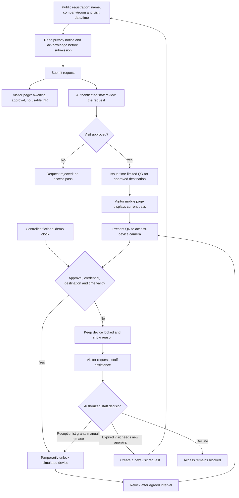

# Heaven Access — Visitor Access Flow

Planning artifact, revised 13 November 2026. Use these diagrams to explain the proposed MVP to the group and as source material for the report and presentation. GitHub renders the Mermaid diagrams below.

[Issue #1](https://github.com/lipex360x/Heaven-Access/issues/1) is the Source of Truth for lifecycle decisions and review. This artifact reflects the accepted single staff role, inclusive ±30-minute Europe/Dublin window, reusable QR and new-request-after-expiry rules. See [design.md](design.md) for screen wireframes.

## Overview for a presentation slide

This is the successful journey. A request alone does not grant access; failed validation keeps the device locked. Delivery and the physical access device are simulated.

## Detailed flow and assistance paths

## How the screens work together

| Stage | Screen / actor | Shared change |
| --- | --- | --- |
| Request | Public registration / visitor | Pending visit appears in the staff interface |
| Review | Staff interface / authorized reviewer | Visitor page reflects the approval decision |
| Pass | Mobile visitor page / visitor | Approved QR and validity details are available |
| Validation | Device simulator / camera | Backend checks the pass using the controlled effective time |
| Access | Device simulator | Device temporarily unlocks or stays locked with a reason |
| Assistance | Staff interface / receptionist | Staff can manually release access; expiry requires a new request and approval |

Screens automatically refresh state through approximately one-second polling in the single Next.js application. This is near-real-time synchronization, not immediate server push; WebSocket/SSE infrastructure is not required for the initial prototype. QR validation and manual-release authorization remain server-side and do not depend on the polling interval.

The public form collects visitor name, seeded company/room destination and scheduled date/time; no email or phone is required. One authenticated staff/reception role can approve, reject and manually release access. The accepted privacy interaction requires an initially unchecked notice acknowledgement before submission. Without acknowledgement, no visit is created; offer reception assistance. Complete notice content, lawful-basis analysis and retention remain under issue #3.

QR authorization is valid from 30 minutes before through 30 minutes after the scheduled time, both boundaries inclusive, in Europe/Dublin. Repeated access within the window is allowed. Expiry requires a new request and approval; the old credential remains expired. The demo clock must be controlled by authorized staff, separate from real session/audit time.

The user requires access counts. Proposed counting semantics for the shared contract: one count per successful QR-authorized unlock, suppressing repeated camera frames while unlocked; denied scans do not count. Manual-release events remain separately identifiable. Display counts in the existing staff interface, without adding a dashboard. Unlock duration and final event/data details remain part of the issue #1 contract.

This flow does not establish occupancy tracking, checkout, physical tailgating prevention or real elevator integration. Cross-building blocking is a future extension, outside the single-building prototype.

See [data-state-contract.md](data-state-contract.md) for the proposed data/API boundary and technical defaults, including five-second unlocks, count deduplication, separate manual events and the controlled advancing demo clock. Clock rewind is a staff-only scenario replay, not a renewal operation; derived time states can change during that replay without changing the stored approval window.
