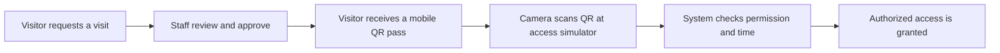
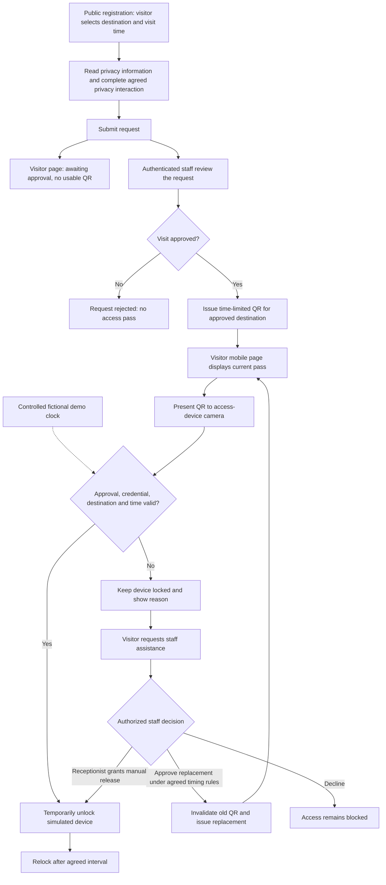

# Heaven Access — Visitor Access Flow

Planning draft, 6 November 2026. Use these diagrams to explain the proposed MVP to the group and as source material for the report and presentation. GitHub renders the Mermaid diagrams below.

[Issue #1](https://github.com/lipex360x/Heaven-Access/issues/1) is the Source of Truth for lifecycle decisions and review. This artifact illustrates the current proposal; unresolved roles, timing, pass reuse, and replacement rules must be agreed there before implementation. See [design.md](design.md) for screen wireframes.

## Overview for a presentation slide

This is the successful journey. A request alone does not grant access; failed validation keeps the device locked. Delivery and the physical access device are simulated.

## Detailed flow and assistance paths

## How the screens work together

| Stage | Screen / actor | Shared change |
| --- | --- | --- |
| Request | Public registration / visitor | Pending visit appears in the staff interface |
| Review | Staff interface / authorized reviewer | Visitor page reflects the approval decision |
| Pass | Mobile visitor page / visitor | Approved QR and validity details are available |
| Validation | Device simulator / camera | Backend checks the pass using the controlled effective time |
| Access | Device simulator | Device temporarily unlocks or stays locked with a reason |
| Assistance | Staff interface / receptionist | Authorized replacement or manual release updates the relevant screens |

Realtime updates should work across the open browser tabs without a manual refresh. A replacement credential does not automatically extend an expired visit; staff must follow the timing/approval rules agreed in the lifecycle issue. Manual release is a separate authenticated action and must not depend on the visitor approving their own request.

The ±30-minute window is still a proposal. The diagram does not establish occupancy tracking, checkout, physical tailgating prevention, or real elevator integration.
